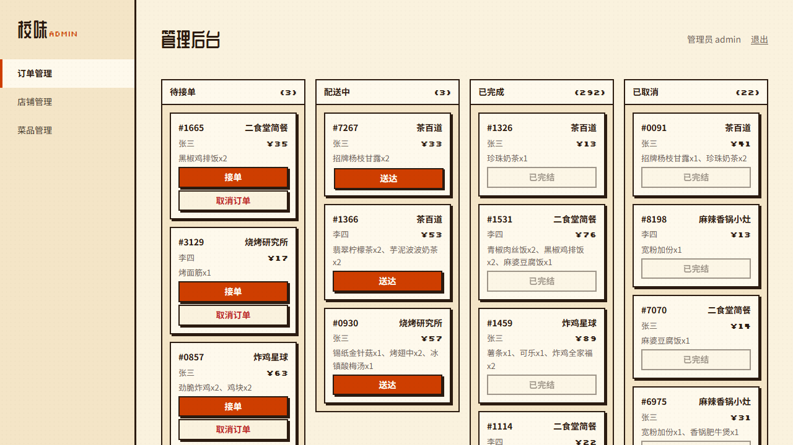

# 校味 CAMPUS EATS

面向校园场景的 PC Web 外卖平台（课程设计）。用户端覆盖「浏览 → 搜索 → 加购 → 下单 → 追踪状态」，后台覆盖「接单推进、店铺与菜品管理、图片上传」。前后端 TypeScript 同仓，单进程可直接部署。

> 当前进度：**阶段一（基础功能）已完成**，阶段二（评价 / 推荐 / 可视化）尚未开始。详见 [SPEC.md](SPEC.md)。



## 功能一览

| 端 | 功能 |
|---|---|
| 用户端 | 首页店铺列表与分类筛选、关键词搜索、店铺详情与菜品分组、购物车（单店模型）、地址管理、下单结算、订单列表与详情、订单状态追踪、取消订单、注册登录 |
| 后台 | 管理员登录、订单看板（接单 / 配送 / 完成 / 取消）、店铺增改与上下架、菜品增改与上下架、分类管理、菜品图片上传 |
| 通用 | JWT 鉴权与角色守卫、统一响应壳与错误码、登录限流、参数校验、价格全整数分存储 |

## 技术栈

| 层 | 选型 |
|---|---|
| 前端 | React 19 + TypeScript + Vite + React Router + Zustand + axios |
| 后端 | Node.js 22 + Express 5 + TypeScript + better-sqlite3 + zod |
| 共享 | `shared/` 提供 DTO 类型、订单状态机、错误码、入参 schema（前后端同一份源码） |
| 测试 | Vitest + supertest（接口）、Playwright（E2E） |
| 部署 | Docker 单镜像（Express 同域托管前端产物）、CloudBase 云托管 |

## 目录结构

```
takeaway/
├── client/                 # React SPA（pages / components / api / styles）
├── server/                 # Express API（modules 按域四件套：routes/controller/service/repo）
│   ├── src/db/             # schema.sql 与启动迁移
│   ├── src/middleware/     # 鉴权、错误处理、限流
│   ├── src/seed/           # 演示数据（含近 30 天历史订单）
│   └── test/               # 接口测试
├── shared/                 # 前后端共用类型与业务规则
├── e2e/                    # Playwright 用例
├── mockup/                 # 视觉稿（HTML + tokens.css / site.css），前端样式直迁自此
├── docs/                   # 架构图、开发过程记录、截图
├── ARCHITECTURE.md         # 架构文档（分层、ADR、数据模型）
├── SPEC.md                 # 需求规格与验收标准
├── PROTOTYPE_DECISIONS.md  # 原型与视觉决策记录
└── CODEBUDDY.md            # 仓库编码规范（AI 协作约束，同时是人工评审清单）
```

## 快速开始

要求 Node.js >= 22。

```bash
npm install          # 安装三个 workspace 的依赖
npm run dev          # 同时启动 API(3000) 与前端(5173)
```

打开 http://localhost:5173 。首次启动时若库为空，会自动建表并灌入演示数据（5 家店铺、若干菜品、近 30 天 300+ 条历史订单）。

演示账号：

| 角色 | 账号 | 密码 | 入口 |
|---|---|---|---|
| 用户 | `zhangsan` | `123456` | `/login` |
| 用户 | `lisi` | `123456` | `/login` |
| 管理员 | `admin` | `123456`（可用 `ADMIN_INITIAL_PASSWORD` 覆盖） | `/login?admin=1`，登录后进入 `/admin/orders` |

## 常用脚本

| 命令 | 说明 |
|---|---|
| `npm run dev` | 前后端并行开发（Vite 代理 `/api`、`/uploads` 到 3000） |
| `npm run build` | 构建前端到 `client/dist` |
| `npm run start` | 仅启动 API（存在 `client/dist` 时同域托管前端） |
| `npm run start:prod` | 构建 + 启动，本地模拟生产 |
| `npm run seed` | 重置并重新灌入演示数据（会清空现有数据） |
| `npm run typecheck` | 三个包全量类型检查 |
| `npm run lint` | ESLint |
| `npm test` | Vitest 接口测试 |
| `npm run test:e2e` | Playwright E2E（需先启动服务） |

质量门禁：`typecheck` 与 `lint` 必须 0 error。

## 配置项

复制 `.env.example` 为 `.env` 后按需修改，服务端仅通过 `server/src/config.ts` 读取。

| 变量 | 默认值 | 说明 |
|---|---|---|
| `PORT` | `3000` | API 监听端口 |
| `JWT_SECRET` | 随机 | 缺省时进程内随机生成，重启后需重新登录 |
| `JWT_EXPIRES_IN` | `24h` | Token 有效期 |
| `DB_PATH` | `./data/app.db` | SQLite 文件路径 |
| `UPLOAD_DIR` | `./uploads` | 图片上传目录（首次上传自动创建） |
| `UPLOAD_MAX_BYTES` | `2097152` | 单图上限，默认 2MB |
| `AUTO_SEED` | `on` | 空库时自动灌入演示数据 |
| `ADMIN_INITIAL_PASSWORD` | `123456` | 空库自举时的管理员口令，公网部署务必覆盖 |
| `AUTO_ACCEPT_ENABLED` | `off` | 模拟自动接单 |
| `AUTO_ACCEPT_INTERVAL_SECONDS` | `30` | 自动接单轮询间隔 |
| `RATE_LIMIT_DISABLED` | `off` | 仅测试用，关闭登录限流 |

## 部署

### Docker

```bash
docker build -t xiaowei .
docker run -d --name xiaowei -p 8080:80 \
  -e JWT_SECRET=your-secret \
  -e ADMIN_INITIAL_PASSWORD=your-admin-password \
  -v xiaowei-data:/app/data \
  -v xiaowei-uploads:/app/uploads \
  xiaowei
```

单容器内 Express 同时提供 API 与前端静态资源，访问 `http://localhost:8080` 即可。

### 云托管

`cloudbaserc.json` 仅声明服务名，端口取镜像内的 `PORT=80`。**副本数必须为 1**：SQLite 与上传目录都在容器本地，多副本会出现「下单后订单不见了」「图片 404」这类数据分裂问题。若要多副本，需把 `data/` 与 `uploads/` 挂到共享存储（如 CFS）。

## 文档索引

| 文档 | 内容 |
|---|---|
| [SPEC.md](SPEC.md) | 需求、验收标准（含可判定指标）、阶段二预留约束 |
| [ARCHITECTURE.md](ARCHITECTURE.md) | 架构分层、ADR、数据模型、接口约定 |
| [PROTOTYPE_DECISIONS.md](PROTOTYPE_DECISIONS.md) | 原型与视觉主题决策 |
| [CODEBUDDY.md](CODEBUDDY.md) | 编码规范（目录边界、分层职责、安全清单） |
| [docs/project-structure.html](docs/project-structure.html) | 架构图（浏览器打开） |
| [docs/story.md](docs/story.md) | 开发过程记录（需求 → 原型 → 架构 → 实现） |

## 已知限制

- 单机 SQLite，无多副本能力；容器重建后数据回到种子状态（除非挂载卷）
- 登录限流基于进程内存计数，多实例时各自独立
- 阶段二功能（评价、推荐、可视化）未实现，`shops.rating` 目前为种子固定值
- 演示账号口令为弱口令，公网部署必须先覆盖 `ADMIN_INITIAL_PASSWORD` 与 `JWT_SECRET`
